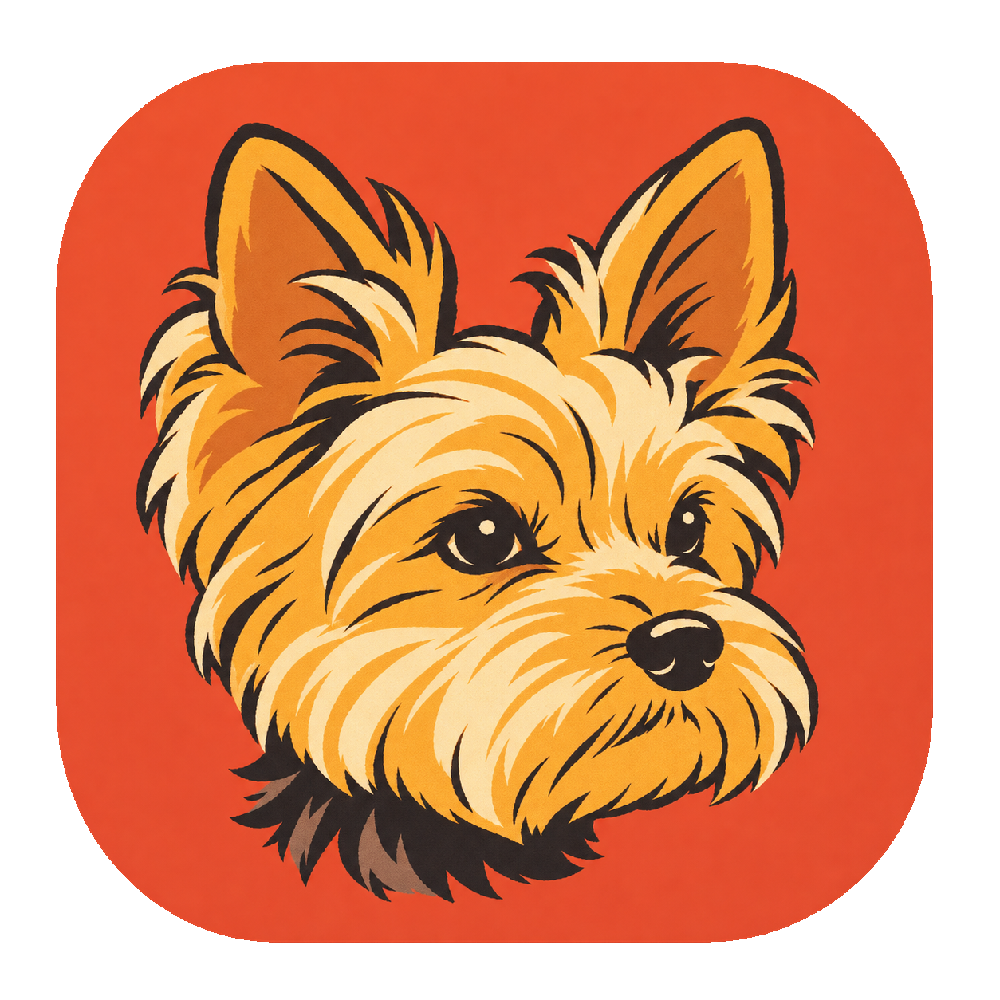
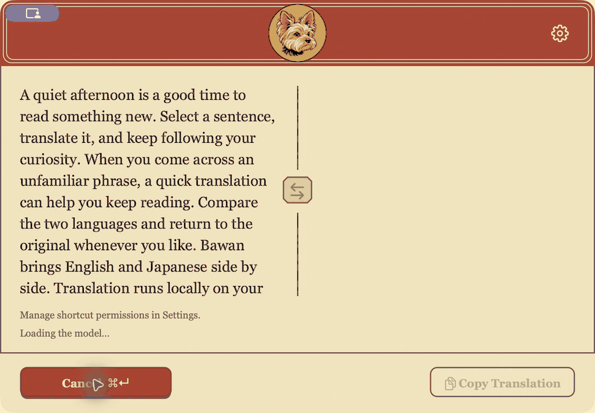

<p align="center">
  
</p>

<h1 align="center">Bawan</h1>

<p align="center">
  <strong>A little companion for English ↔ Japanese translation.</strong><br>
  Native to your Mac. Local by design. Just a double copy away.
</p>

<p align="center">
  
  
  
  <a href="LICENSE"></a>
</p>

<p align="center">
  <a href="#building--installing">Build & Install</a> ·
  <a href="#setup--usage">Usage & Shortcuts</a> ·
  <a href="#model--licenses">Model & Licenses</a>
</p>

<p align="center">
  
</p>

<p align="center">
  <sub>English → Japanese · Real on-device translation, streamed into the app window.<br>
  <a href="design/screenshots/README.md">Recording details & UI stills</a></sub>
</p>

---

## ✨ Meet Bawan

Bawan is a resident English ↔ Japanese translation app for Apple Silicon Macs running macOS 14 or later.

Select text in any app and press `⌘C` twice within 400 ms to display the source text and translation near your cursor. You can also press `⌥T` twice—or choose **Open Translator** from the menu bar—to open the window for manual input. Both global shortcuts can be enabled, disabled, and customized individually in **Settings…**.

Bawan stays resident in the Dock and `⌘Tab` switcher after you close the translation panel. The panel comes to the front when invoked and behaves like a standard window afterward, moving behind other apps when unfocused.

### Made for the little moments between languages

| Everyday translation | At home on macOS |
| --- | --- |
| **⌘C ×2 · Translate where you are**<br>Select text in any app and double-copy to bring Bawan near your cursor. | **🔒 Local & private**<br>Translate offline after model setup. No translation history files or logs. |
| **⇄ · Two languages, side by side**<br>Read the original and translation together, stream results, and swap direction in one click. | **🐾 A Mac companion**<br>Paper textures, a dog mascot, Light/Dark appearance, and support for Reduce Motion and Increase Contrast. |
| **⚡ Native all the way down**<br>AppKit + Objective-C++ + C++17, with statically linked `llama.cpp` and local Metal inference. No Electron, Rust, Python, or external inference server. | **💤 Ready when you need it**<br>The model loads on first use and unloads after 60 seconds of inactivity. Streaming keeps your place when you scroll back. |

<a id="building--installing"></a>

## 📦 Building & Installing

### Prerequisites

- Apple Silicon Mac (macOS 14+)
- Apple Command Line Tools and CMake

### Build from Source

```sh
xcode-select --install
cmake --version
./scripts/build.sh
open build/Bawan.app
```

The first build downloads `llama.cpp` (`b12307`) and verifies its SHA256 checksum. All downloads, intermediate files, and the built app stay inside `build/`. Subsequent runs perform incremental builds. End users do not need CMake or developer tools to run the built app.

### Install to Applications

For regular use, quit the app, copy it to `/Applications`, and launch it from there before granting macOS permissions or enabling Launch at Login:

```sh
ditto build/Bawan.app /Applications/Bawan.app
open /Applications/Bawan.app
```

Builds use ad-hoc signing by default. To sign with your own identity:

```sh
./scripts/build.sh -DBAWAN_SIGNING_IDENTITY="Apple Development: Your Name (TEAMID)"
```

To clean build artifacts, quit Bawan and delete `build/`. The downloaded model in Application Support and your macOS permissions are stored separately.

<a id="setup--usage"></a>

## ⌨️ Setup & Usage

1. **Model download:** Before the first model setup, Bawan shows a summary of the model license with links to the official terms and commercial registration. After you continue, Bawan downloads the official PLaMo model (~573 MB) and verifies its file size and SHA256 checksum. Progress appears in the window and menu bar. If setup fails, choose **Retry Model Setup** from the menu.
2. **Permissions:** Open **Settings…** from the menu bar (or the gear icon) and grant the permissions shown for your shortcuts:
   - **Input Monitoring** is required for the default `⌘C` ×2 selection translation.
   - **Accessibility** is required for opening the translator (`⌥T` ×2) or using a custom shortcut for selection translation.
   - Manual translation via **Open Translator** works without either permission.
3. **Translate selected text:** Highlight text in another app and press `⌘C` twice (releasing `⌘` between presses also works).
4. **Translate manually:** Press `⌥T` twice or select **Open Translator**. Invoking the shortcut while the window is already open preserves its position, text, and translation state while focusing the source field.

### In-Window Shortcuts

| Action | Shortcut |
| --- | --- |
| Translate / Cancel active translation | `⌘Return` |
| Copy translation | `⌘⇧C` |
| Swap source and translation | `⇄` button |
| Close translator | `Esc` / `⌘W` |

In Settings, `Esc` cancels shortcut recording first; otherwise it returns to the translator with text, scroll position, and editing history preserved. `⌘W` closes the shared window when shortcut recording is inactive.

### Customizing Shortcuts

| Action | Default | Permission Required |
| --- | --- | --- |
| Translate selected text | `⌘C` (2 presses) | Input Monitoring |
| Open translator | `⌥T` (2 presses) | Accessibility |

In **Settings…**, click **Shortcut (click)** to record a new key combination and choose **1** or **2** presses:

- Shortcuts must combine at least one modifier (`⌘`, `⌥`, or `⌃`) with a regular key.
- Reserved app shortcuts (`⌘Return`, `⌘⇧C`, `⌘Q`, `⌘,`) and combinations already used by the other active action cannot be assigned.
- Double-press shortcuts require both presses within 400 ms, releasing the key between presses without holding it down, pressing other keys, or switching apps.
- Unlike the default `⌘C` ×2 (which preserves normal copy behavior), custom shortcuts are intercepted from the first press and are not forwarded to the active app even if a double-press is not completed.
- Custom shortcuts for selection translation trigger a copy in the active app after key release and require Accessibility permission.

### Translation Behavior

- **Auto-direction:** Text containing kana or kanji translates Japanese → English; all other text translates English → Japanese. Clicking `⇄` flips the previous direction rather than re-detecting from the translated text.
- **Limits:** Designed for a few sentences up to a few paragraphs (4,096-token input limit including prompt overhead; 4,096-token output limit, using Q4_K_M weights and F16 KV cache). Oversized input is rejected with a message; output that reaches the generation limit is marked incomplete.
- **Clipboard safety:** If copying selected text fails (e.g., copy-protected views, image-only selections, or Secure Keyboard Entry), Bawan will not translate stale clipboard contents. Use manual input in these cases or if clipboard access is denied.

### Model Location

```text
~/Library/Application Support/local.bawan.Bawan/plamo-3-translate-0.8b-Q4_K_M.gguf
```

Bawan uses its own bundle ID and storage directory and does not migrate models or settings from other apps.

## 🧪 Testing & Verification

Tests, smoke checks, and profiling tools are excluded from standard release builds. To build and run them locally on Apple Silicon:

```sh
./scripts/build.sh -DBAWAN_BUILD_TESTS=ON -DBAWAN_BUILD_SMOKE=ON
cmake --build build --target short_input_tests shortcut_tests shortcut_preferences_tests panel_smoke settings_smoke mascot_smoke app_delegate_smoke engine_lifecycle engine_event_mailbox_tests engine_smoke engine_profile --parallel 3
ctest --test-dir build --output-on-failure
./build/engine_smoke "$HOME/Library/Application Support/local.bawan.Bawan/plamo-3-translate-0.8b-Q4_K_M.gguf"
```

You can also run single-string inference or resource profiling against a local GGUF model:

```sh
./build/engine_smoke /path/to/model.gguf 'The meeting has been moved to next Monday.'
./build/engine_profile /path/to/model.gguf
```

On Linux, you can build and test the CPU inference engine without the macOS app target:

```sh
cmake -S . -B build -DBAWAN_BUILD_APP=OFF -DBAWAN_BUILD_TESTS=ON -DBAWAN_BUILD_SMOKE=ON
cmake --build build --parallel
ctest --test-dir build --output-on-failure
./build/engine_smoke /path/to/model.gguf
```

GitHub Actions CI is not used; run builds, signature checks, and real-model tests locally. Live shortcut permissions and key interception checks, full-window UI acceptance, and whole-app resource measurements remain unrecorded. See the [UI QA record](design-qa.md) for evidence and outstanding checks. Engine profiling excludes AppKit and does not establish whole-app memory use or Metal performance from Linux RSS.

<a id="model--licenses"></a>

## 📜 Model & Licenses

Bawan's original code and project-owned artwork are released under the
[MIT License](LICENSE). The dog artwork is a composite based on the author's own
dog. Third-party libraries and model weights retain their own licenses.

- **Inference:** [llama.cpp / ggml b12307](https://github.com/ggml-org/llama.cpp/tree/b12307)
  is MIT-licensed, including the MIT-licensed llamafile, YaRN and ggllm.cpp code
  used by the inference library. Full copyright and permission notices are in
  [THIRD_PARTY_NOTICES.md](resources/THIRD_PARTY_NOTICES.md).
- **Model:** Built with PLaMo. The official
  [PLaMo 3 Translate 0.8B GGUF Q4_K_M](https://huggingface.co/pfnet/plamo-3-translate-0.8b-GGUF)
  is downloaded separately, unmodified, under the **PLaMo Community License**.
  It is not covered by the app's MIT License.

Personal and non-commercial use, including academic use, is free without prior
registration. Commercial use, **including internal business use**, requires prior
PFN registration when the user or its affiliates' most recent fiscal-year revenue
or sales does not exceed **JPY 1 billion**; above that threshold, a separate
commercial agreement is required. Making Bawan free or MIT-licensed does not
remove those model conditions.

See [Model usage terms](resources/MODEL_USAGE.md) for registration, redistribution
and translation-output guidance, and the official agreement
([Japanese](https://plamo.preferredai.jp/info/plamo-community-license-ja),
[English](https://plamo.preferredai.jp/info/plamo-community-license-en)) for the
governing terms. This summary reflects the November 9, 2026 revision.

The first model setup shows the usage summary. You can reopen it through
**Model License…** in the menu bar or application menu. App and library licenses,
third-party notices and the model usage guide are bundled in the app's
`Contents/Resources` directory.
